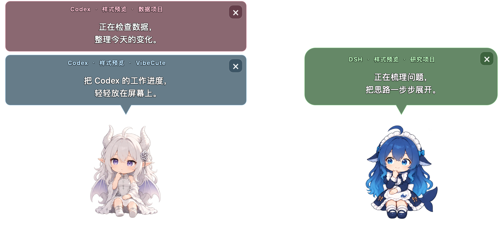

# VibeCute

让Agent的工作状态，变成桌面上看得见的陪伴。

VibeCute （目前）是一款使用 Swift、AppKit 和 SwiftUI 构建的原生 macOS 菜单栏应用。它读取所选 AI 工具的本地会话数据，用桌面角色和字幕展示工作进度、回复与提问，也支持独立于会话的桌面陪伴，以及随声音变化的口型和唱歌动作。

## 界面预览

多个项目的进度可以分别显示，并由不同角色呈现：




## 功能

- **连接 AI 工具**：支持 Codex、Claude Code、DeepSeek、豆包、OpenCode 和 WorkBuddy；实际可显示的信息取决于相应工具的本地数据。
- **桌面角色与字幕**：呈现工作状态、回复和提问，支持角色绑定、逐字显示与闲置互动。
- **独立陪伴**：不连接 AI 工具，也可以显示桌面角色。
- **声音互动**：通过声音分类、BeatNet+ 节拍跟踪和 MFCC 辅助口型，让角色随声音做出反应。
- **任务提示**：提供任务音效，以及数据可用时的额度和速度显示。

## 安装

运行环境：**macOS 15.0 或更新版本**。安装包按架构提供：

| Mac 类型 | 选择的安装包 |
| --- | --- |
| Apple Silicon（M 系列芯片） | 文件名含 `arm64` 的 DMG |
| Intel | 文件名含 `x86_64` 的 DMG |

打开对应的 DMG，将 **VibeCute.app** 拖入 **Applications**，再从应用程序目录启动。首次运行按新手引导设置权限，并选择需要连接的工具。连接功能需要本地存在对应工具生成的可读取会话数据。

当前本地构建使用持久的本机证书签名，**尚未经过 Apple 公证**。Intel 构建已通过 Rosetta 回归检查；原生 Intel 真机的实时音频性能尚未验收。

## 权限与数据

VibeCute 需要读取用户选择的工具会话目录。涉及截屏、系统音频或麦克风的功能，按所用功能和 macOS 要求申请权限。

角色显示和会话解析在本机进行，BeatNet+ 推理使用包内模型。部分功能存在网络访问，例如 DeepSeek 额度查询会使用对应凭据请求 DeepSeek 服务。

提交 Issue、日志或截图前，请移除会话内容、账户信息和凭据。不要将 API Key、签名证书、会话日志或本地运行输出提交到仓库。

## 从源码构建

需要 Xcode Command Line Tools、Python 3、Git 和相应构建依赖。首次准备 BeatNet+ 时会下载固定版本的 CMake 和 ggml，并在项目的 `.build/` 中构建。

### 开发版

```sh
xcode-select --install  # 已安装时跳过
brew install zstd
python3 scripts/setup_signing.py
bash scripts/setup_beatnet.sh
bash scripts/build.sh development
```

产物：`dist/development/VibeCute Dev.app`。

开发版保留未完成的实验功能；Whisper 和人声分离等可选运行时需另外准备，不会因构建开发版而自动下载。开发版使用独立的应用标识、偏好与缓存，可与正式版并存。

### 正式版 DMG

完成依赖和签名准备后：

```sh
# 按本机架构构建
bash scripts/package-release.sh

# 在 Apple Silicon 上交叉构建 Intel 版
bash scripts/package-release.sh x86_64
```

本机架构产物位于 `dist/release/`；Apple Silicon 上的 Intel 交叉构建产物位于 `dist/release/x86_64/`。Intel 交叉构建会另外编译 x86_64 版 BeatNet+ 与 Zstandard；运行 Intel 回归检查需要安装 Rosetta。

正式版配置固定在 [`config/build-profiles/release.json`](config/build-profiles/release.json)：节拍方案仅 BeatNet+，口型方案为 MFCC；不打包 Kira 菜单与彩蛋、Apple Speech、Whisper、人声分离、CutOut、工作台和开发者工具。粉色小熊已退役，不随源码资源或构建产物分发。

打包脚本执行签名、资源与架构检查、核心回归及 DMG 挂载回读。详细说明见 [发布文档](docs/RELEASE.md)。自己的持久签名证书可通过 `CAPTIONS_SIGNING_IDENTITY` 和 `CAPTIONS_SIGNING_KEYCHAIN` 配置；签名私钥不属于仓库内容。

## 开发与检查


欢迎提交 Issue 和 Pull Request。报告问题时请附上 macOS 版本、芯片架构、应用版本、复现步骤及脱敏后的必要信息。

## 许可与署名

本仓库按内容分别授权，第三方代码、模型与素材遵循各自许可。

### 项目代码：GNU GPL v3

VibeCute 的项目代码采用 [GNU General Public License v3.0](LICENSE)（SPDX：`GPL-3.0-only`，仅第 3 版）。使用、修改和分发代码须遵守 GPL v3；分发修改版本或二进制时，应按协议履行许可声明与对应源码提供等义务。GPL v3 允许商业使用代码，但不替代下述角色形象、模型权重和第三方组件的各自授权。

### 角色形象：CC BY-NC-SA 4.0

**形象原作者：上善无形 ZipZipPipe。**

角色形象及对应美术素材采用 [CC BY-NC-SA 4.0（署名—非商业性使用—相同方式共享）](https://creativecommons.org/licenses/by-nc-sa/4.0/)。使用或分发时须保留署名和许可链接；修改后须标明改动。不得用于商业目的，分发改编作品时须遵循相同方式共享要求。详见 [角色素材授权说明](LICENSE-ASSETS.md)。


### 第三方组件

| 组件 | 原项目 | 许可或限制 | 说明 |
| --- | --- | --- | --- |
| BeatNet+ C++ 代码 | [key2/beatnetplus.cpp](https://github.com/key2/beatnetplus.cpp) | MIT | [接入说明](Sources/BeatNetBridge/UPSTREAM.md) |
| BeatNet+ 模型权重 | [上游模型与授权说明](https://github.com/key2/beatnetplus.cpp#dependencies-and-licenses) | 仅限非商业使用 | 不适用本项目的 GPL v3 或角色素材许可 |
| ggml | [ggml-org/ggml](https://github.com/ggml-org/ggml) | MIT | 随 BeatNet+ 运行时保留许可 |
| PocketFFT | [mreineck/pocketfft](https://github.com/mreineck/pocketfft) | BSD-3-Clause | 保留上游头文件声明 |
| Zstandard | [facebook/zstd](https://github.com/facebook/zstd) | 保留上游许可 | [随附许可](Resources/Zstandard-LICENSE.txt) |
| aubio | [aubio/aubio](https://github.com/aubio/aubio) | GPL-3.0-or-later | [接入说明](Sources/AubioBridge/UPSTREAM.md)，仅开发/实验构建 |
| BTrack | [adamstark/BTrack](https://github.com/adamstark/BTrack) | GPL-3.0-or-later | [接入说明](Sources/BTrackBridge/UPSTREAM.md)，仅开发/实验构建 |
| Kiss FFT | [mborgerding/kissfft](https://github.com/mborgerding/kissfft) | 随附 BSD 许可 | 随 BTrack 保留原始声明 |
| libsamplerate | [libsndfile/libsamplerate](https://github.com/libsndfile/libsamplerate) | BSD-2-Clause | 随 BTrack 保留原始声明 |

正式版排除 aubio、BTrack 及其专用依赖。项目代码统一采用 GPL v3；第三方组件保留原始版权及许可声明，分发时须同时履行适用条款。商业使用角色素材或 BeatNet+ 权重，需要另行取得相应授权或替换相关内容。

安装包的 `Licenses/` 目录及 App 内 `Contents/Resources/Licenses/` 均附带项目 GPL、角色授权说明、CC BY-NC-SA 4.0 完整法律文本与第三方声明。
